# Realtime 第一階段架構分析

分析日期：2026-10-10。來源為目前工作樹，起始 HEAD 為 `f3ef90be7dde36a0cdf909986cfc2d9dbe62d15b`。本階段不修改 RVC 推論路徑、不更換模型、F0、Embedder 或大型依賴。

## 目標與安全界線

優先維持自然年輕女性中文聲線、聲調與咬字、無電子雜音、不中斷，再評估延遲及成本。使用現有 RVC v2／40k／HiFi-GAN／RMVPE／Custom Chinese HuBERT。現有 RMS 衰減修正、裝置與 lifecycle 防護、UI 記憶保留。

已有 WDF_VIOLATION 紀錄。使用者於本輪明確允許恢復 GPU Benchmark，並禁止實體 Stream；已實測 CUDA Pipeline、獨立階段 Events、短段 kernel trace、Offline 參考及輸出波形 F0。實體 Stream、真實端到端延遲與主觀女聲品質仍 NOT TESTED。GPU 已確認 RTX 4080 SUPER，driver 591.86，PyTorch CUDA build 12.8；成功量測不代表先前藍畫面原因已排除。

起始工作樹有未追蹤 `AGENTS.md`、`docs/CUSTOMIZATION.md`；不建立／切換 branch 或 worktree，不 stash/reset。沿用 `v3.6.5/self-enhance-realtime-perfermance`，新增工具、測試、獨立文件目錄來隔離變更。沒有 commit 或 push。

## 從裝置到裝置

```mermaid
flowchart LR
    A[輸入裝置／PortAudio callback] --> B[Input gain／mono]
    B --> C[非阻塞 input Queue]
    C --> D[spawn worker]
    D --> E[48k→16k／RMS／warmup／VAD]
    E --> F[F0 視窗／pitch cache]
    F --> G[HuBERT 完整 context]
    G --> H[Index suffix 檢索／特徵保護]
    H --> I[RVC generator／RMS envelope／可選後處理]
    I --> J[模型取樣率→48k／SOLA／crossfade]
    J --> K[GPU→CPU／output Queue]
    K --> L[callback 取最近結果或重播]
    L --> M[Output gain／聲道複製／輸出裝置]
```

主程序的 `AudioCallbacks.change_voice()` 呼叫 `VoiceChangerWorker.submit()` 和 `retrieve()`，不在裝置 callback 中等待 GPU。worker 以 Windows `spawn` 建立獨立程序，單一迴圈同步處理一個 chunk；內部 CUDA kernel 排程則可非同步。主程序、worker、PortAudio callback、Queue feeder 與 PyTorch CPU thread pool 不是同一執行緒。

input/output Queue 各 `maxsize=2`。input 滿時丟新輸入；worker 清除舊輸出；retrieve 消耗可取得的結果並保留最後一份。未取得新結果時 callback 重播上一 chunk，首次則輸出 zeros。這避免阻塞，卻可能造成重複音節；目前未帶 sample sequence ID，不能由 UI performance 值判斷重播／丟塊比例。

`Audio.audio_queue()` 已使用 `get_nowait()`，取最舊 pending block 後清除 snapshot backlog，空 Queue 輸出 zeros。monitor Queue 沒有固定容量；不平衡時仍需實際觀察，但本次不改策略。callback 內有 gain、mono、聲道複製、Queue 操作；發生例外仍有既有 print/traceback，正常路徑未新增 logging、磁碟 I/O、鎖或等待。

`audio.py` 保留 name + Host API 即時解析、channels/sample rate/float32/backend 驗證與清理。Stream 存在或啟動中不可重設 PortAudio。裝置支援不同取樣率的條件需另查；`core.py` 的模型介面固定 48k，Benchmark 也固定輸入／輸出 48k，不聲稱已驗證非 48k 實體裝置。

## 每個處理環節

以下「成本」是原始碼結構；沒有真實模型的每 chunk 毫秒數。可量測階段見最後一節。

| 環節與位置 | 同步、搬移及配置 | 音質／deadline 影響 |
|---|---|---|
| callback、`audio.py`／`callbacks.py` | CPU gain/mono/repeat 會配置 ndarray；Queue 經序列化及程序間搬移；不等待模型 | callback 遲到、Queue 滿、重播可能造成卡頓；純 Pipeline 不涵蓋此成本 |
| `Realtime.inference` 輸入 | `torch.as_tensor(..., device)` 將 CPU float32 上傳；torchaudio Resample 在模型裝置；RMS `.item()` 是 GPU→CPU 同步點 | resampler 已在初始化建立；每 chunk 仍有 tensor／resample 輸出配置；RMS 只供診斷／靜音，未重新乘到最終輸出 |
| `utils/torch.circular_write` | 已預先配置 audio/convert/pitch buffers；實作為 shift + `detach().clone()`，並非 O(1) ring buffer | 不改聲音但有 clone／copy 暫存；改寫成 ring buffer 需證明連續 context 等價，不能只換函式名稱 |
| warmup／VAD／threshold | warmup 填 buffer 並推論但輸出 zeros；VAD 另做 D2H `.cpu().numpy().copy()`、int16 PCM 及 WebRTC CPU 分類；VAD 尾端不足一 frame 會被忽略 | VAD 可截斷氣音、低音量與清音；靜音仍推論舊 buffer 以維持時脈，不是省略模型。CPU zeros 可在 GPU 完成前返回 |
| `Realtime_Pipeline.get_f0` | RMVPE 模型常駐；tensor mel、網路、GPU local cents 解碼；量化／transpose；pitch cache shift 使用 clone | 已只估最近視窗，邊界裁 `[3:-1]` 後覆寫 cache；保留聲調的能力需獨立 F0／人工測試，不能從 cache 存在推定 |
| `hubert_model(feats)` | 每 chunk 重新編碼完整 context；v2 使用 last_hidden_state，v1 才用 final_proj；cat 最後一 frame，use_f0 時 clone feats0 | 長 context 有利穩定咬字，也可能是主要成本。不能僅為降 latency 自動縮短 2.5 s |
| `IndexWrapper.search` | 啟動時 CPU FAISS reconstruct 全向量，GPU 常駐 tensor + b_norms；每次 `addmm`、distance clamp、topk，再 gather/mix | 搜尋的是 `skip_head//2` 後 suffix，並非整個 context；GPU 是全 Index 暴力 L2，nprobe 只在 CPU FAISS 使用。OOM/RuntimeError 可切至 CPU，新增 D2H/H2D 與時延波動 |
| 特徵 upsample／protect | interpolate 2×、pitch slice；protect<0.5 才進入 V/UV 混合，feats0 仍在 use_f0 時 clone | protect=0.5 並非額外啟用清音混合；刪除「看似多餘」clone 前須量測多參數與模型版本 |
| `RealtimeVoiceConverter.inference`／Synthesizer | generator FP32；enc_p 處理 context；以 rate 裁掉舊 latent 後 flow/decoder 只生成 return 部分；`rate.item()` 會同步；`randn_like` 含隨機項；最後 clip [-1,1] | 不可把 generator 視為完全只算 250 ms；clip 也可能掩蓋原模型超範圍，需要保留 raw output 旗標 |
| Volume Envelope | GPU RMS frame/pad/as_strided、square/mean/interpolate/pow；resampler/幾個 scalar 已重用，RMS 中間 tensor 每次生成 | envelope 調整後與 crossfade 仍可能超過 ±1；保留目前 envelope，不能恢復額外輸入 RMS 衰減 |
| 可選降噪／Pedalboard | TorchGate 在裝置；Pedalboard 是 D2H → CPU effect → H2D | 會改音質並增加搬移；第一階段 preset 關閉 Pedalboard，不支援其參數，必須明確報錯 |
| output resample | 預先建好的模型取樣率→48k torchaudio transform | speech 路徑使用 `resample_out(audio_model)`；warmup/silence 直接回 CPU zeros，不能用其 shape 推定 speech latency |
| SOLA／Crossfade | GPU conv1d 分子／能量分母，argmax 後 tensor offset slicing；`not sola_buffer.any()` 涉及 CPU 條件同步；phase 或線性 onset fade；tail buffer 重用，短輸出才 pad/cat | 10 ms search + crossfade 保持邊界連續；SOLA 位移使 source/output 時間不能無條件逐 sample 比較 |
| 最終回傳 | speech `.detach().cpu().numpy()` 等待 GPU；配置 CPU waveform；錄音功能可在 worker 寫檔，本工具強制關閉 | worker 完成時間不是裝置的 round-trip。兩程序、driver buffers、遊戲 GPU 競爭、Discord/OBS 均未涵蓋 |

Realtime pipeline 明確固定 `dtype=torch.float32`，即使 assets 設定 precision 為 fp16，也不能假設此路徑是 FP16。模型載入時已移除 parametrizations；HuBERT、F0、index/resampler 常駐；worker/client 已比較 embedder selector 與 custom path，無需再加快取層。

## 250 ms／50 ms／2.5 s 的確切尺寸

此為 UI 原始預設值及歷史使用情境；`ui_settings.json` 尚未保存 Realtime page，不能宣稱已確認正在執行的即時 UI 值。

- 48k block=12,000、crossfade=2,400、SOLA search=480、extra=120,000 samples。
- 16k convert context=44,960 samples=2.81 s；hop=160，feature length=281。
- skip_head=250、return_length=31 frames=310 ms；pitch buffers=282 frames。
- RMVPE 最近視窗由 4,000+800 向上取到 `5120*k-160`，為 4,960 samples=310 ms；不重新估整個 2.81 s。
- startup warmup=`ceil(44960/4000)+1`=13 blocks=3.25 s。這是既有 buffer warmup；Benchmark 初始化暖身另外執行，不能把兩者混用。啟動後前段 zeros 在輸出 WAV 中保留，統計分開。

## Phase Vocoder 的複雜度

`phase_vocoder()` 不只有 rFFT。它以 `arange(n)[:,None]` 與頻率 bins 建立所有時間點×頻率的相位矩陣、cos、sum，工作與暫存近似 O(N²)。50 ms 的 N=2400，矩陣 2,882,400 個 FP32 元素約 11.53 MB（11.0 MiB），而且有多份中間結果；不是峰值實測。200 ms 時 N=9600，單份矩陣約 184 MB，約為 16 倍。SOLA 的 conv1d 本身也是 crossfade 長度×search positions 的工作。

實測 50 ms 的 Phase Vocoder：完整診斷 host p50 4.89 ms／stream span p50 5.96 ms；短段 trace 的 kernel duration p50 約 0.0905 ms，不是主要成本。SOLA correlation 的短段 kernel p50 約 13.99 ms，值得另行研究。不同 pass、背景負載及 profiler 開銷不能混成正常 latency。不能直接換成簡單 iFFT：目前相位差含 fractional-bin 演進，等價性須證明；切到線性 crossfade 也會改音質。

## 已重現的 coarse F0 差異

Offline `rvc/infer/pipeline.py` 使用 `f0_mel_min/max`；Realtime `pipeline.py` 卻將 mel 值減 `f0_min`（Hz）並除以 Hz 範圍。CPU 測試呼叫兩份實際 `get_f0()`，僅替代 RMVPE 網路輸出：

| 同一 fine F0 | Offline coarse | Realtime coarse |
|---|---|---|
| 50 Hz | 1 | 8 |
| 1100 Hz | 255 | 246 |

fine F0 相同，coarse conditioning 不同。此測試證明 baseline 演算法差異，沒有證明哪一份在現有女聲模型的聽感較好。未修改它，下一階段需獨立、可切換的品質實驗，不能當作「不改變推論結果」的效能 prototype。

Offline 另有 high-pass、reflect padding、全段 F0／切句、CPU FAISS retrieval、RMS 與輸出 peak 正規化；Realtime 有 streaming cache/VAD/SOLA/PV 與 generator clip。相同資產與控制參數仍不代表兩條路徑數值等價。Offline RMVPE 的高音校正讀 assets 設定，Realtime 固定關閉；目前設定為關閉，未強制改寫設定。

## 獨立量測設計

正常應用不 import 新工具，production 檔案不增加計時分支、hook 或同步，預設沒有額外負擔。`benchmark.py` 預設 audit；run 要明確 opt-in，僅 `VoiceChanger.process_audio`，不 import `AudioCallbacks`／不開 Stream。

正常 pass 量測 worker 相同呼叫的 host wall service time 與 process CPU time；speech 的 D2H 本來就會等待。不在每 chunk 插入 CUDA fence，保持既有行為；silent 的未完成 GPU 工作可能延至後塊，最後 warmup 的 GPU 成本可能落到第一個 steady chunk。服務時間 RTF 不是 GPU busy ratio，也不代表所有 GPU 工作已完成；另回報含最後 CUDA fence 的 completed_passes 整輪 RTF，包含 startup warmup 與輸出保留／RSS 取樣，與 steady-state 指標分開。輸入連續送入，是飽和服務成本模擬，未模擬定時裝置 arrival 或 idle clock 波動。

`--profile` 才另跑相同來源、參數、seed、重設 buffer 與 VAD 的診斷 pass。暫時包裝模型物件／函式，在 finally 還原；不得把此 context 用到正在執行的 UI 或多執行緒推論。CPU scope 記錄 inclusive/exclusive；CUDA Event 在當前 stream 記錄，整 chunk 完成後同步一次再讀取。CUDA 數字是 stream 時間跨度，可含 CPU 排程空洞；不是 kernel time 相加。原理依 [PyTorch 2.11 Event 文件](https://docs.pytorch.org/docs/2.11/generated/torch.cuda.Event.html)。`--trace` 的 shape/memory profiler 是額外診斷負擔，與正常數據分離，依 [PyTorch profiler 文件](https://docs.pytorch.org/docs/2.11/profiler.html)。

可直接分段：input/output resample、buffer write、VAD CPU、F0（含量化）、content encoder、index retrieval、generator、volume envelope、noise reduction、SOLA 兩次 correlation、Phase Vocoder，以及 frontend/conversion/chunk 整體。多次呼叫先按 chunk 加總再取百分位；沒有執行的階段不得填零。

不能獨立精確分段的部分：輸入 H2D、RMS 同步及 VAD 的 D2H 位於 frontend exclusive；F0 cache copy／feature interpolation 在 conversion exclusive；SOLA offset/onset/線性交叉淡化／padding／最終 D2H 在 chunk exclusive。這些 residual 包含多個操作，不冒稱單一環節 latency；需要 trace 判讀。CPU-only 整合測試已用真實 resampling/cache/SOLA/PV/RMS 驗證 hook 不改 waveform 與 buffer 狀態，僅模型網路用小型替代物。

## 已量測的成本與限制

完整正常 pass：345 個穩態 chunks，p50/p95/p99=138.24/200.86/222.16 ms，250 ms deadline miss 2 次。GPU 有其他背景負載，這不是 idle GPU 或真實 callback 結果。

完整 Event 診斷的 host scope 前三為 Generator、RMVPE/F0、HuBERT；Generator/F0 的 host 呼叫與 stream 跨度含大量啟動／同步等待，不能解讀成網路純計算。短段 trace 以 GPU event 的 External id 連回 CPU op，再歸屬最內層 scope，純 kernel p50 前三改為 HuBERT 22.66 ms、SOLA 13.99 ms、Generator 4.81 ms。RMVPE/F0 約 3.49 ms，但每塊約 832 個 kernels；Generator 約 1043 個。這是縮小啟動成本的證據，尚非某項改寫可加速的證明。完整表及原始資料見 [baseline_report.md](baseline_report.md)。

GPU 正常重跑相同 seed 的最大 sample 差異約 0.000556；profiling 對正常第一輪約 0.000472。CPU fixture 已證明 bitwise 等價，但真實 GPU bitwise 尚未證明；第一階段不修改推論算法。`f0_evaluation.py` 使用既有 RMVPE 從三份完整 WAV 獨立估計，不讀 generator pitch cache；依實際 startup 決定共同評估起點，固定延遲及敏感度另記錄，不內插 V/UV。動態 pitch 模式拒絕使用固定升調誤差比較。
